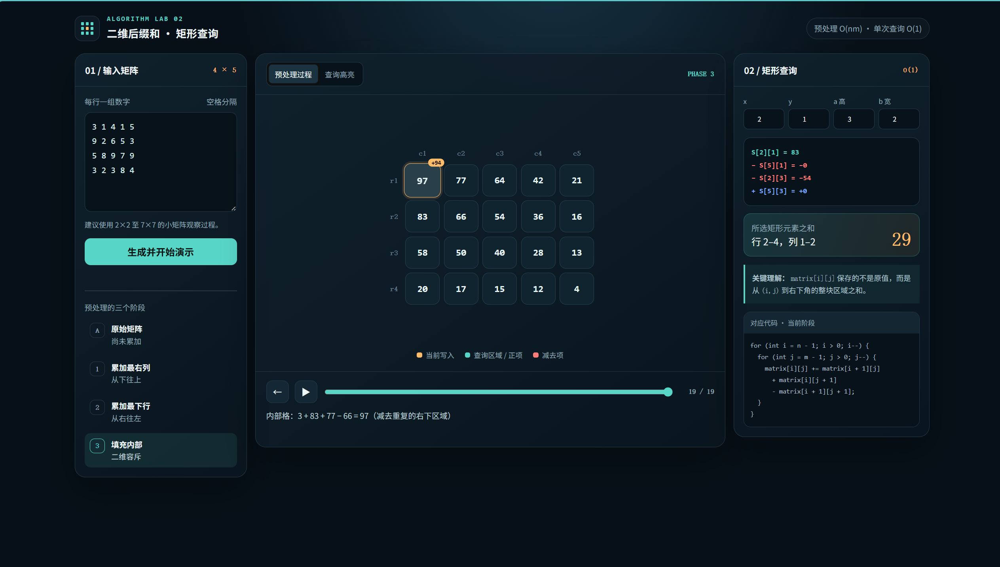

# LAB1实验报告

报告人：龚宇熙  计55班  2025010516

## 0A

1. 提示词：
   
    我是一个数据结构初学者，你是我的DSA学习助手。这是我们课程的编程作业指引，帮我总结一下如何从数据结构助教那里获得帮助（简单扼要地回答）

2. LLM输出：

```
根据作业指引，向数据结构助教求助主要有两种方式：

线上答疑：在网络学堂课程答疑区发帖，适合问题面歧义、解题思路、课程相关问题，一般会在24 小时内回复。但线上通常不会直接帮你具体调试代码，只会提示调试方向。
线下辅导：按网络学堂公告参加，可以和助教讨论解题思路、具体代码调试、课程学习问题。如果人多，助教会优先帮你找到“下一步该怎么查”的方向。

一个很实用的原则是：如果自己卡了大约半小时，没有实质进展，也不知道下一步做什么，就该求助了，不要一直死磕。

另外，别拖到截止前一天再问，那时助教不保证能及时回复。
```

3. LLM对话链接：https://chatgpt.com/share/6aaa8f1d-164c-83ec-9fc0-24e90c05e1df

## 2C

1. 提示词：
   1. 这是一个数据结构题目的例题。这里有两个和这个题目相关的问题，帮我回答一下

   2. 你的回答中有错误，重新进行回答

   3. 你的回答还是有问题，给个不同的答案出来
   
   4. 你的判断还是有问题，再次给出答案

2. LLM输出情况
   
   LLM一开始的回答其实是正确的，能够通过1s执行$ 10^{8} $条指令估算出大致的答案；在我第一次告诉它回答错误之后，LLM进行了更严谨、谨慎的回答，它说1s执行$ 10^{8} $条指令是不准确的，所以这个答案不能直接给出答案，目前LLM的回答都是可接受的；在我第2次告诉它回答错误之后，LLM又开始想要通过估算给出答案，但这时LLM又认为1s大约可以执行$ 10^{9} $条指令，这与它之前的判断明显矛盾；在我第3次告诉它回答错误之后，LLM直接将题目中对输入规模的限制作为了答案，而不是进行计算，但是这显然不是正确答案。
   
3. 我的启发

    LLM能够比较容易地一次给出答案，但是在不断地质疑和反思中反而会失去正确回答的能力，而且会产生比较严重的幻觉。LLM不会质疑人类的判断，即使它很明显是对的，它也会毫不犹豫地推翻自己。
   
4. LLM对话链接：https://chatgpt.com/share/6aaa925f-c56c-83ec-9290-05dc74b55db1

## 3A, 3B, 3C, 3D, 3E

### 3A:

1. 问题：两个代码中sum的结果在每次循环开始时没有正确清空，导致一直计算累加值

    找到方式：代码静态分析

2. 问题：solution_2.cpp的行前缀计算下标错误。```rowsum[y+b] - rowsum[y] ```算的是第 y+1 到 y+b 列；应改为 ```rowsum[y+b-1] - rowsum[y-1]```

    找到方法：调试器

3. 问题：两份代码的 int sum 都可能溢出。

    找到方法：LLM

4. 问题：当 n 或 m 等于 2000，数组会越界。

    找到方法：LLM

### 3B:

需要在编译时加入 -g 选项。-g 会保留类似源代码行号、变量名、函数名等调试信息，因此 GDB 才能把正在执行的机器指令对应回源程序中的具体语句

### 3C:

```srand(time(0));``` 的作用是：给伪随机数生成器设置一个随机种子，让后续 ```rand() ```每次运行程序时更可能产生不同的随机数序列。

### 3D:

每次 ```system(...) ```执行的其实都是一条 Shell 命令：

```system("g++ rand_input.cpp -o rand_input");```编译随机数据生成器 rand_input.cpp，生成可执行文件 rand_input。

```system("g++ check_input.cpp -o check_input");```编译输入检查程序 check_input.cpp，生成 check_input。

```system("g++ solution_1.cpp -o solution_1");```编译第一个解法，生成 solution_1。

```system("g++ solution_2.cpp -o solution_2");```编译第二个解法，生成 solution_2。

### 3E:

结果的绝对值最多为：$ 4 \times 10^{11} $

应该使用 64 位整数 ```long long```

LLM对话链接：https://chatgpt.com/share/6aaa9b08-1c04-83ec-9132-68178c0a62af

## 4A, 4B, 4C, 4D

### 4A
算法思路：

```solution_1.cpp```中将子数组中的每个元素进行遍历求和；```solution_2.cpp```中将当前元素到行末元素进行了求和，使得求子数组和时只需要遍历所有行即可。

受到这个启发，```solution_3.cpp```在获取```matrix```之后，将```matrix[i][j]```计算为从```(i, j)```位置到```(n, m)```子数组元素之和，这样在求起始位置为```(x, y)```，大小为```(a, b)```的子数组之和时，只需要用```matrix[x][y]```减去```matrix[x + a][y]```和```matrix[x][y + b]```，然后再加上重复减去的```matrix[x + a][y + b]```

### 4B
当```(n,m,q)```都固定时，三个程序的实际运行时间通常还会和每次询问的子矩阵大小有关。```solution_1.cpp```的时间复杂度是```O(ab)```，```solution_2.cpp```的时间复杂度是```O(a)```，```solution_3.cpp```的时间复杂度是```O(1)```。

### 4C

**数据生成方式**：修改 `rand_input.cpp` 中生成随机n、m、x、y、a、b、v的方法

数据生成和编译不计入用时；对同一份输入，分别用 Bash 的 `time` 测量程序从读入到结束的时间。每个单元格为 **7 次有效运行的平均值 ± 样本标准差**，单位为秒；标准差按 $s=\sqrt{\sum_{i=1}^{7}(t_i-\bar t)^2/6}$ 计算。

| $n\times m$ | $q$ | `solution_1` / s | `solution_2` / s | `solution_3` / s |
| --- | ---: | ---: | ---: | ---: |
| $500\times500$ | 20000 | 0.0816 ± 0.0005 | 0.0121 ± 0.0004 | 0.0091 ± 0.0004 |
| $1000\times1000$ | 20000 | 0.0263 ± 0.0005 | 0.0303 ± 0.0013 | 0.0281 ± 0.0007 |
| $1000\times1000$ | 20000 | 0.0300 ± 0.0006 | 0.0306 ± 0.0029 | 0.0274 ± 0.0011 |
| $1000\times1000$ | 20000 | 0.0481 ± 0.0007 | 0.0670 ± 0.0024 | 0.0289 ± 0.0045 |
| $1000\times1000$ | 20000 | 0.3241 ± 0.0018 | 0.0419 ± 0.0015 | 0.0280 ± 0.0000 |
| $1000\times1000$ | 2000 | 0.4669 ± 0.0027 | 0.0350 ± 0.0023 | 0.0257 ± 0.0005 |
| $2000\times2000$ | 500 | 0.5899 ± 0.0367 | 0.0997 ± 0.0005 | 0.0950 ± 0.0013 |

### 4D
当询问次数多，且子矩阵通常很高时，```solution_3.cpp```的优势最明显。它预处理一次后，每次询问只需常数次运算；```solution_2.cpp``` 每次仍要累加a行。若子矩阵同时很宽，``` solution_1.cpp``` 还要逐个遍历其中的元素，差距会更大。

## 5A, 5B

### 5A
**网页截图：**


**HTML代码：** 见报告最后

### 5B
LLM对话链接：https://chatgpt.com/share/6aace4c8-1db4-83ec-9e09-deba607c8f48

LLM回答内容见报告最后


## 5A HTML代码
```
<!doctype html>
<html lang="zh-CN">
<head>
  <meta charset="utf-8">
  <meta name="viewport" content="width=device-width,initial-scale=1">
  <meta name="description" content="逐步理解二维后缀和预处理与矩形区域查询">
  <title>二维后缀和算法可视化</title>
  <link rel="icon" type="image/svg+xml" href="data:image/svg+xml,%3Csvg xmlns='http://www.w3.org/2000/svg' viewBox='0 0 64 64'%3E%3Crect width='64' height='64' rx='12' fill='%2309141d'/%3E%3Cg fill='none' stroke='%2357d6c7' stroke-width='4'%3E%3Cpath d='M12 12h40v40H12zM12 25h40M12 39h40M25 12v40M39 12v40'/%3E%3C/g%3E%3Crect x='27' y='27' width='10' height='10' rx='2' fill='%23ffbd6b'/%3E%3C/svg%3E">
  <style>
    :root{--bg:#071018;--panel:#0d1923;--panel2:#10212d;--line:#263b49;--text:#eef6f7;--muted:#91a8b5;--cyan:#57d6c7;--cyan2:#2a8d86;--amber:#ffbd6b;--red:#ff7d78;--blue:#79a9ff;--shadow:0 22px 60px rgba(0,0,0,.28)}
    *{box-sizing:border-box}html{color-scheme:dark;scroll-behavior:smooth}body{margin:0;background:radial-gradient(circle at 55% -10%,#163243 0,transparent 38%),var(--bg);color:var(--text);font:16px/1.55 Inter,"Noto Sans SC","Microsoft YaHei",sans-serif;min-height:100vh}
    button,input,textarea{font:inherit}button{cursor:pointer}.shell{width:min(1440px,calc(100% - 32px));margin:auto;padding:24px 0 48px}.topbar{display:flex;align-items:center;justify-content:space-between;margin-bottom:20px}.brand{display:flex;align-items:center;gap:12px}.mark{display:grid;grid-template-columns:repeat(3,5px);gap:3px;padding:10px;border:1px solid var(--line);border-radius:12px;background:#0d1923}.mark i{width:5px;height:5px;background:var(--cyan);border-radius:1px}.mark i:nth-child(5){background:var(--amber)}h1{font-size:1.1rem;margin:0;letter-spacing:.02em}.eyebrow{color:var(--cyan);font:700 .72rem/1 ui-monospace,SFMono-Regular,Consolas,monospace;text-transform:uppercase;letter-spacing:.15em;margin-bottom:5px}.badge{border:1px solid var(--line);border-radius:99px;padding:7px 12px;color:var(--muted);font-size:.82rem;background:rgba(13,25,35,.75)}
    .workspace{display:grid;grid-template-columns:290px minmax(440px,1fr) 330px;gap:14px;align-items:start}.card{border:1px solid var(--line);border-radius:18px;background:linear-gradient(145deg,rgba(16,33,45,.97),rgba(10,21,30,.97));box-shadow:var(--shadow);overflow:hidden}.card-head{display:flex;align-items:center;justify-content:space-between;padding:16px 17px;border-bottom:1px solid var(--line)}.card-head h2{font-size:.93rem;margin:0}.step-tag{font:700 .72rem/1 ui-monospace,monospace;color:var(--amber)}.card-body{padding:16px}.label{display:flex;justify-content:space-between;color:var(--muted);font-size:.8rem;margin-bottom:7px}.matrix-input{width:100%;min-height:168px;resize:vertical;border:1px solid var(--line);border-radius:11px;background:#07121a;color:#d9f2f0;padding:12px;font:500 .9rem/1.7 ui-monospace,SFMono-Regular,Consolas,monospace;outline:none}.matrix-input:focus,input:focus{border-color:var(--cyan);box-shadow:0 0 0 3px rgba(87,214,199,.11)}.hint{color:var(--muted);font-size:.76rem;margin:7px 0 14px}.primary,.secondary{border:0;border-radius:10px;padding:10px 13px;font-weight:750}.primary{width:100%;background:var(--cyan);color:#061513}.primary:hover{filter:brightness(1.08)}.secondary{background:#172b38;color:var(--text);border:1px solid var(--line)}.divider{height:1px;background:var(--line);margin:18px 0}.phase-list{display:grid;gap:7px}.phase{display:grid;grid-template-columns:27px 1fr;gap:9px;align-items:start;padding:9px;border-radius:10px;color:var(--muted);font-size:.79rem}.phase strong{display:block;color:var(--text);font-size:.82rem}.phase .num{display:grid;place-items:center;width:25px;height:25px;border:1px solid var(--line);border-radius:8px;font:700 .7rem ui-monospace,monospace}.phase.active{background:rgba(87,214,199,.1);color:#c4d7dc}.phase.active .num{border-color:var(--cyan);color:var(--cyan)}
    .stage{min-height:650px}.stage-head{padding:14px 18px;border-bottom:1px solid var(--line);display:flex;align-items:center;justify-content:space-between;gap:12px}.tabs{display:flex;background:#07121a;border:1px solid var(--line);border-radius:10px;padding:3px}.tab{border:0;background:transparent;color:var(--muted);border-radius:7px;padding:7px 11px;font-size:.78rem}.tab.active{background:#1b3340;color:var(--text)}.status{font:600 .77rem ui-monospace,monospace;color:var(--cyan)}.canvas{padding:28px 22px 18px;min-height:430px;display:flex;align-items:center;justify-content:center;overflow:auto}.matrix-wrap{display:grid;grid-template-columns:26px auto;grid-template-rows:26px auto;gap:6px;align-items:center}.col-heads,.matrix-grid{display:grid;gap:7px}.row-heads{display:grid;gap:7px}.axis{height:54px;display:grid;place-items:center;color:#607b89;font:700 .72rem ui-monospace,monospace}.col-heads .axis{height:26px}.row-heads .axis{width:26px}.cell{position:relative;width:58px;height:54px;border:1px solid #28404e;border-radius:11px;background:#102430;display:grid;place-items:center;font:700 .98rem ui-monospace,SFMono-Regular,Consolas,monospace;transition:.25s transform,.25s background,.25s border-color;color:#e7f4f4}.cell.original{background:#102430}.cell.region{background:rgba(87,214,199,.18);border-color:var(--cyan)}.cell.focus{transform:scale(1.07);background:#29404a;border-color:var(--amber);box-shadow:0 0 0 3px rgba(255,189,107,.13)}.cell.lookup-plus{border-color:var(--cyan);box-shadow:inset 0 0 0 2px rgba(87,214,199,.2)}.cell.lookup-minus{border-color:var(--red);box-shadow:inset 0 0 0 2px rgba(255,125,120,.18)}.cell.lookup-corner{border-color:var(--blue);box-shadow:inset 0 0 0 2px rgba(121,169,255,.2)}.cell .delta{position:absolute;top:-8px;right:-6px;border-radius:99px;padding:1px 5px;background:var(--amber);color:#1e1306;font-size:.57rem}.legend{display:flex;justify-content:center;gap:18px;color:var(--muted);font-size:.75rem;padding:0 12px 18px;flex-wrap:wrap}.legend span{display:flex;align-items:center;gap:6px}.dot{width:9px;height:9px;border-radius:3px;background:var(--cyan)}.dot.amber{background:var(--amber)}.dot.red{background:var(--red)}
    .player{border-top:1px solid var(--line);padding:15px 18px}.player-row{display:grid;grid-template-columns:auto auto 1fr auto;align-items:center;gap:10px}.icon-btn{width:38px;height:38px;border-radius:10px;border:1px solid var(--line);background:#142734;color:var(--text);font-size:.95rem}.step-range{width:100%;accent-color:var(--cyan)}.counter{min-width:62px;text-align:right;color:var(--muted);font:700 .75rem ui-monospace,monospace}.explain{margin-top:11px;min-height:48px;color:#bfd0d6;font-size:.83rem}.explain code{color:var(--amber)}
    .query-grid{display:grid;grid-template-columns:repeat(4,1fr);gap:7px}.query-grid label{color:var(--muted);font-size:.7rem}.query-grid input{width:100%;margin-top:4px;padding:8px 5px;border:1px solid var(--line);border-radius:8px;background:#07121a;color:var(--text);text-align:center}.formula{background:#07121a;border:1px solid var(--line);border-radius:12px;margin-top:14px;padding:13px;font:600 .76rem/1.8 ui-monospace,SFMono-Regular,Consolas,monospace;overflow:auto}.fplus{color:var(--cyan)}.fminus{color:var(--red)}.fcorner{color:var(--blue)}.result{display:flex;align-items:end;justify-content:space-between;margin-top:13px;padding:13px;border-radius:12px;background:linear-gradient(100deg,rgba(87,214,199,.13),rgba(255,189,107,.08));border:1px solid rgba(87,214,199,.3)}.result small{display:block;color:var(--muted)}.result strong{font:800 2rem/1 ui-monospace,monospace;color:var(--amber)}.codebox{margin-top:14px;border:1px solid var(--line);border-radius:12px;overflow:hidden}.code-title{padding:9px 11px;background:#142632;color:var(--muted);font-size:.72rem}.code{margin:0;padding:11px;background:#07121a;color:#a9bcc5;font:500 .69rem/1.75 ui-monospace,SFMono-Regular,Consolas,monospace;white-space:pre-wrap}.code .hi{color:var(--amber);background:rgba(255,189,107,.09);display:block;margin:0 -11px;padding:0 11px}.callout{margin-top:14px;padding:12px;border-left:3px solid var(--cyan);background:rgba(87,214,199,.07);color:#adc1c9;font-size:.78rem}.error{color:var(--red);font-size:.77rem;min-height:18px;margin-top:7px}
    @media(max-width:1100px){.workspace{grid-template-columns:250px 1fr}.right{grid-column:1/-1;display:grid;grid-template-columns:1fr 1fr}.right .card-head{grid-column:1/-1}.right .card-body{display:contents}.query-pane,.code-pane{padding:16px}.query-pane{border-right:1px solid var(--line)}}
    @media(max-width:760px){.shell{width:min(100% - 18px,680px);padding-top:12px}.badge{display:none}.workspace{display:block}.card{margin-bottom:12px}.stage{min-height:0}.canvas{padding:20px 8px;justify-content:flex-start}.cell{width:48px;height:46px;font-size:.83rem}.axis{height:46px}.right{display:block}.right .card-body{display:block}.query-pane{border-right:0}.player-row{grid-template-columns:auto auto 1fr}.counter{grid-column:1/-1;text-align:left}.topbar{margin:4px 2px 14px}}
  </style>
</head>
<body>
  <main class="shell">
    <header class="topbar">
      <div class="brand"><span class="mark" aria-hidden="true"><i></i><i></i><i></i><i></i><i></i><i></i><i></i><i></i><i></i></span><div><div class="eyebrow">Algorithm Lab 02</div><h1>二维后缀和 · 矩形查询</h1></div></div>
      <div class="badge">预处理 O(nm) · 单次查询 O(1)</div>
    </header>
    <section class="workspace">
      <aside class="card">
        <div class="card-head"><h2>01 / 输入矩阵</h2><span class="step-tag" id="dimTag">4 × 5</span></div>
        <div class="card-body">
          <label class="label" for="matrixInput"><span>每行一组数字</span><span>空格分隔</span></label>
          <textarea id="matrixInput" class="matrix-input" spellcheck="false">3 1 4 1 5
9 2 6 5 3
5 8 9 7 9
3 2 3 8 4</textarea>
          <div class="hint">建议使用 2×2 至 7×7 的小矩阵观察过程。</div>
          <button class="primary" id="buildBtn">生成并开始演示</button>
          <div class="error" id="inputError" role="alert"></div>
          <div class="divider"></div>
          <div class="label"><span>预处理的三个阶段</span></div>
          <div class="phase-list" id="phaseList">
            <div class="phase active" data-phase="0"><span class="num">A</span><span><strong>原始矩阵</strong>尚未累加</span></div>
            <div class="phase" data-phase="1"><span class="num">1</span><span><strong>累加最右列</strong>从下往上</span></div>
            <div class="phase" data-phase="2"><span class="num">2</span><span><strong>累加最下行</strong>从右往左</span></div>
            <div class="phase" data-phase="3"><span class="num">3</span><span><strong>填充内部</strong>二维容斥</span></div>
          </div>
        </div>
      </aside>

      <section class="card stage">
        <div class="stage-head"><div class="tabs" role="tablist"><button class="tab active" id="processTab" role="tab">预处理过程</button><button class="tab" id="queryTab" role="tab">查询高亮</button></div><div class="status" id="status">ORIGINAL MATRIX</div></div>
        <div class="canvas"><div class="matrix-wrap" id="matrixWrap"></div></div>
        <div class="legend"><span><i class="dot amber"></i>当前写入</span><span><i class="dot"></i>查询区域 / 正项</span><span><i class="dot red"></i>减去项</span></div>
        <div class="player">
          <div class="player-row"><button class="icon-btn" id="prevBtn" aria-label="上一步">←</button><button class="icon-btn" id="playBtn" aria-label="播放或暂停">▶</button><input class="step-range" id="stepRange" type="range" min="0" max="1" value="0" aria-label="演示步骤"><span class="counter" id="counter">0 / 0</span></div>
          <div class="explain" id="explain">从原始矩阵开始。点击播放，观察代码如何原地把每个格子改成右下区域之和。</div>
        </div>
      </section>

      <aside class="card right">
        <div class="card-head"><h2>02 / 矩形查询</h2><span class="step-tag">O(1)</span></div>
        <div class="card-body">
          <div class="query-pane">
            <div class="query-grid">
              <label>x<input id="qx" type="number" min="1" value="1"></label><label>y<input id="qy" type="number" min="1" value="2"></label><label>a 高<input id="qa" type="number" min="1" value="2"></label><label>b 宽<input id="qb" type="number" min="1" value="3"></label>
            </div>
            <div class="formula" id="formula"></div>
            <div class="result"><div><small>所选矩形元素之和</small><span id="rangeText">—</span></div><strong id="resultValue">0</strong></div>
            <div class="callout"><b>关键理解：</b> <code>matrix[i][j]</code> 保存的不是原值，而是从 <code>(i,j)</code> 到右下角的整块区域之和。</div>
          </div>
          <div class="code-pane">
            <div class="codebox"><div class="code-title">对应代码 · 当前阶段</div><pre class="code" id="codeBox"></pre></div>
          </div>
        </div>
      </aside>
    </section>
  </main>
  <script>
  (()=>{
    const $=id=>document.getElementById(id);
    const els={input:$('matrixInput'),error:$('inputError'),build:$('buildBtn'),wrap:$('matrixWrap'),range:$('stepRange'),counter:$('counter'),explain:$('explain'),status:$('status'),play:$('playBtn'),prev:$('prevBtn'),dim:$('dimTag'),formula:$('formula'),result:$('resultValue'),rangeText:$('rangeText'),code:$('codeBox'),processTab:$('processTab'),queryTab:$('queryTab')};
    let original=[],steps=[],index=0,timer=null,view='process';
    const code={0:'// 原始矩阵：还未预处理',1:'for (int i = n - 1; i > 0; i--) {\n  matrix[i][m] += matrix[i + 1][m];\n}',2:'for (int j = m - 1; j > 0; j--) {\n  matrix[n][j] += matrix[n][j + 1];\n}',3:'for (int i = n - 1; i > 0; i--) {\n  for (int j = m - 1; j > 0; j--) {\n    matrix[i][j] += matrix[i + 1][j]\n      + matrix[i][j + 1]\n      - matrix[i + 1][j + 1];\n  }\n}',4:'sum = matrix[x][y]\n    - matrix[x + a][y]\n    - matrix[x][y + b]\n    + matrix[x + a][y + b];'};
    function parse(text){const rows=text.trim().split(/\n+/).map(r=>r.trim().split(/\s+/).map(Number));if(!rows.length||rows.some(r=>!r.length||r.some(v=>!Number.isFinite(v))))throw Error('请输入有效数字。');if(rows.length>7||rows[0].length>7)throw Error('为了清晰展示，请不要超过 7×7。');if(rows.length<2||rows[0].length<2)throw Error('矩阵至少需要 2×2。');if(rows.some(r=>r.length!==rows[0].length))throw Error('每一行的数字个数需要相同。');return rows}
    const clone=m=>m.map(r=>r.slice());
    function buildSteps(mat){const s=[{m:clone(mat),phase:0,cell:null,text:'从原始矩阵开始。点击播放，观察代码如何原地把每个格子改成右下区域之和。'}];let cur=clone(mat),n=cur.length,cols=cur[0].length;
      for(let i=n-2;i>=0;i--){let before=cur[i][cols-1];cur[i][cols-1]+=cur[i+1][cols-1];s.push({m:clone(cur),phase:1,cell:[i,cols-1],delta:cur[i+1][cols-1],text:`最右列：matrix[${i+1}][${cols}] = ${before} + ${cur[i+1][cols-1]} = ${cur[i][cols-1]}`})}
      for(let j=cols-2;j>=0;j--){let before=cur[n-1][j];cur[n-1][j]+=cur[n-1][j+1];s.push({m:clone(cur),phase:2,cell:[n-1,j],delta:cur[n-1][j+1],text:`最下行：matrix[${n}][${j+1}] = ${before} + ${cur[n-1][j+1]} = ${cur[n-1][j]}`})}
      for(let i=n-2;i>=0;i--)for(let j=cols-2;j>=0;j--){let before=cur[i][j],down=cur[i+1][j],right=cur[i][j+1],overlap=cur[i+1][j+1];cur[i][j]+=down+right-overlap;s.push({m:clone(cur),phase:3,cell:[i,j],delta:down+right-overlap,text:`内部格：${before} + ${down} + ${right} − ${overlap} = ${cur[i][j]}（减去重复的右下区域）`})}return s}
    function processed(){return steps[steps.length-1].m}
    function query(){if(!original.length)return null;let n=original.length,m=original[0].length,x=+$('qx').value,y=+$('qy').value,a=+$('qa').value,b=+$('qb').value;x=Math.max(1,Math.min(n,x));y=Math.max(1,Math.min(m,y));a=Math.max(1,Math.min(n-x+1,a));b=Math.max(1,Math.min(m-y+1,b));[['qx',x],['qy',y],['qa',a],['qb',b]].forEach(([k,v])=>$(k).value=v);const p=processed(),at=(r,c)=>r<n&&c<m?p[r][c]:0;const A=at(x-1,y-1),B=at(x-1+a,y-1),C=at(x-1,y-1+b),D=at(x-1+a,y-1+b);return{x,y,a,b,A,B,C,D,sum:A-B-C+D}}
    function render(){const step=steps[index],mat=view==='query'?processed():step.m,n=mat.length,m=mat[0].length,q=query();els.wrap.innerHTML='';const corner=document.createElement('div');els.wrap.append(corner);const ch=document.createElement('div');ch.className='col-heads';ch.style.gridTemplateColumns=`repeat(${m},58px)`;for(let j=1;j<=m;j++){let a=document.createElement('div');a.className='axis';a.textContent='c'+j;ch.append(a)}els.wrap.append(ch);const rh=document.createElement('div');rh.className='row-heads';for(let i=1;i<=n;i++){let a=document.createElement('div');a.className='axis';a.textContent='r'+i;rh.append(a)}els.wrap.append(rh);const g=document.createElement('div');g.className='matrix-grid';g.style.gridTemplateColumns=`repeat(${m},58px)`;
      for(let i=0;i<n;i++)for(let j=0;j<m;j++){const c=document.createElement('div');c.className='cell '+(view==='process'&&index===0?'original':'');c.textContent=mat[i][j];if(view==='process'&&step.cell&&step.cell[0]===i&&step.cell[1]===j){c.classList.add('focus');let d=document.createElement('span');d.className='delta';d.textContent=(step.delta>=0?'+':'')+step.delta;c.append(d)}if(view==='query'&&q){if(i>=q.x-1&&i<q.x-1+q.a&&j>=q.y-1&&j<q.y-1+q.b)c.classList.add('region');const key=`${i},${j}`;if(key===`${q.x-1},${q.y-1}`)c.classList.add('lookup-plus');if(key===`${q.x-1+q.a},${q.y-1}`||key===`${q.x-1},${q.y-1+q.b}`)c.classList.add('lookup-minus');if(key===`${q.x-1+q.a},${q.y-1+q.b}`)c.classList.add('lookup-corner')}g.append(c)}els.wrap.append(g);
      els.range.value=index;els.counter.textContent=`${index} / ${steps.length-1}`;els.explain.textContent=view==='query'?'青色区域就是原矩阵中从 (x,y) 开始、高 a、宽 b 的查询范围。边界外的后缀和按 0 处理。':step.text;els.status.textContent=view==='query'?'RANGE QUERY':step.phase===0?'ORIGINAL MATRIX':`PHASE ${step.phase}`;document.querySelectorAll('.phase').forEach(p=>p.classList.toggle('active',+p.dataset.phase===step.phase));els.code.textContent=code[view==='query'?4:step.phase];renderQuery(q);if(innerWidth<=760){ch.style.gridTemplateColumns=`repeat(${m},48px)`;g.style.gridTemplateColumns=`repeat(${m},48px)`}}
    function renderQuery(q){if(!q)return;els.formula.innerHTML=`<span class="fplus">S[${q.x}][${q.y}] = ${q.A}</span><br><span class="fminus">− S[${q.x+q.a}][${q.y}] = −${q.B}</span><br><span class="fminus">− S[${q.x}][${q.y+q.b}] = −${q.C}</span><br><span class="fcorner">+ S[${q.x+q.a}][${q.y+q.b}] = +${q.D}</span>`;els.result.textContent=q.sum;els.rangeText.textContent=`行 ${q.x}–${q.x+q.a-1}，列 ${q.y}–${q.y+q.b-1}`}
    function setView(v){view=v;els.processTab.classList.toggle('active',v==='process');els.queryTab.classList.toggle('active',v==='query');if(v==='query'){index=steps.length-1;stop()}render()}
    function rebuild(){try{original=parse(els.input.value);steps=buildSteps(original);index=0;els.range.max=steps.length-1;els.dim.textContent=`${original.length} × ${original[0].length}`;els.error.textContent='';setLimits();setView('process')}catch(e){els.error.textContent=e.message}}
    function setLimits(){let n=original.length,m=original[0].length;$('qx').max=n;$('qy').max=m;$('qa').max=n;$('qb').max=m}
    function stop(){clearInterval(timer);timer=null;els.play.textContent='▶'}function play(){if(timer){stop();return}if(index>=steps.length-1)index=0;els.play.textContent='Ⅱ';timer=setInterval(()=>{if(index<steps.length-1){index++;render()}else stop()},700)}
    els.build.onclick=rebuild;els.range.oninput=e=>{index=+e.target.value;stop();setView('process')};els.prev.onclick=()=>{stop();index=Math.max(0,index-1);setView('process')};els.play.onclick=play;els.processTab.onclick=()=>setView('process');els.queryTab.onclick=()=>setView('query');['qx','qy','qa','qb'].forEach(id=>$(id).addEventListener('input',()=>setView('query')));window.addEventListener('resize',()=>render());
    function registerTools(){const mc=document.modelContext;if(!mc?.registerTool)return;const schema={type:'object',properties:{x:{type:'integer'},y:{type:'integer'},height:{type:'integer'},width:{type:'integer'}},required:['x','y','height','width'],additionalProperties:false};try{mc.registerTool({name:'visualize_range_query',title:'显示矩形查询',description:'设置二维矩阵中的查询起点、矩形高度和宽度，并显示四项容斥结果。',inputSchema:schema,annotations:{readOnlyHint:false,untrustedContentHint:false},execute(v){if(!v||![v.x,v.y,v.height,v.width].every(Number.isInteger))throw Error('查询参数必须是整数');$('qx').value=v.x;$('qy').value=v.y;$('qa').value=v.height;$('qb').value=v.width;setView('query');const q=query();return{range:{x:q.x,y:q.y,height:q.a,width:q.b},sum:q.sum}}})}catch(e){console.debug('WebMCP unavailable',e)}}
    rebuild();registerTools();
  })();
  </script>
</body>
</html>

```


## 5B LLM回答内容
如果我是这门课的助教，只根据你现在这份 `REPORT.md` 来批，我会给 **84/100 左右**。整体已经不是“把答案填完”的报告了，能看出你确实做了调试、实验、LLM 对照和性能测试；最影响分数的不是代码知识点，而是**实验报告的论证还不够完整**。

我大致会这样给分：

| 维度        |         分数 | 评价                                     |
| --------- | ---------: | -------------------------------------- |
| 完成度       |      16/20 | 前面较完整，但 `5B` 目前是空的，5A 也只是说明截图和 HTML 位置 |
| 技术正确性     |      25/30 | 大部分判断正确，但复杂度分析还可以更严谨                   |
| 实验设计与数据分析 |      22/30 | 做了多次测量、均值和标准差，这很好；但实验变量没有记录清楚          |
| 思考与反思     |      17/20 | 2C、3A 能明显看到自己的尝试过程，这是报告里比较好的部分         |
| 表达规范      |        4/5 | 基本清楚，但部分结论过于绝对，表格也缺少说明                 |
| **总分**    | **84/100** | 有内容、有实验，但还需要把“为什么得到这个结论”写扎实            |

### 我最建议你优先改的，是 4C

你这里已经写了一个挺正规的测量方式：

> 同一输入测 7 次，报告平均值 ± 样本标准差。 

这个做法其实很好，甚至比一般第一次实验报告认真得多。但现在**表格缺了最关键的自变量**。

例如你的表格里连续四组都是：

`n=m=1000, q=20000`

但运行时间却从：

`solution_1 = 0.0263 → 0.0300 → 0.0481 → 0.3241`

变化了十几倍。

我作为助教看到这里第一反应会是：

> “这四组实验到底改变了什么？”

从你前面的分析来看，你应该是在改变询问矩形的 `a、b`，但表里没写，所以**读者没法从实验数据验证你的结论**。

这是最值得改的一项。建议变成类似：

| n×m       |     q |    a 范围 |    b 范围 | solution_1 | solution_2 | solution_3 |
| --------- | ----: | ------: | ------: | ---------: | ---------: | ---------: |
| 1000×1000 | 20000 |    1~10 |    1~10 |        ... |        ... |        ... |
| 1000×1000 | 20000 |   1~100 |   1~100 |        ... |        ... |        ... |
| 1000×1000 | 20000 | 400~500 | 400~500 |        ... |        ... |        ... |

这样你的实验立刻就“活”了：老师一眼就能看出 **随着 `a,b` 增大，三种算法分别发生什么变化**。

---

### 4B 的复杂度分析建议再严谨一点

你目前写的是：

> `solution_1` 为 `O(ab)`，`solution_2` 为 `O(a)`，`solution_3` 为 `O(1)`。

如果题目问的是**一次查询**的复杂度，这个回答没问题。

但如果是在分析整个程序，最好区别：

**预处理复杂度 + 查询复杂度。**

比如你的 `solution_3` 并不是真的整个程序 `O(1)`，而是：

$$
\text{预处理 }O(nm),\qquad
\text{单次查询 }O(1)
$$

有 `q` 次查询时，总体就是：

$$
O(nm+q)
$$

同理，三个程序最好分别写成“总运行复杂度”。这会比只写 `O(ab)`、`O(a)`、`O(1)` 更像一份 DSA 实验报告，也更能解释为什么**查询少的时候预处理成本可能反而占主要部分**。

这也正好能解释你实验中 `q=500` 时，`solution_2` 和 `solution_3` 的差距很小。

---

### 4D 可以从“描述现象”升级成“解释数据”

你现在的结论是：

> 查询次数多、矩形高时 `solution_3` 优势明显；矩形宽时 `solution_1` 更慢。

方向是对的，但我建议不要只讲理论，而是**直接引用自己的实验结果**。

例如可以写成：

> 当查询矩形较小时，三种实现的理论复杂度虽然不同，但输入、循环控制和预处理等固定开销占比较大，因此实际运行时间差异并不明显。随着查询矩形高度和宽度增大，`solution_1` 每次查询需要访问的元素数量迅速增加，而 `solution_3` 的查询开销基本不变，因此差距逐渐扩大。另一方面，当 `q` 较小时，`solution_3` 的二维预处理成本在总时间中的比例增大，所以它与 `solution_2` 的实际差距会缩小。

这就有了很明显的“**理论 → 实验 → 解释**”链条。

---

### 2C 的观察不错，但结论不要说得太绝对

这一部分其实是我比较喜欢的。你没有单纯贴 LLM 答案，而是真的做了一个“小实验”：连续告诉模型“你错了”，观察它如何改变答案，而且记录了前后矛盾。

但是这句话：

> “LLM不会质疑人类的判断，即使它很明显是对的，它也会毫不犹豫地推翻自己。”

有点过度概括。

你这次实验实际上只能支持一个更准确的结论：

> **LLM 在受到连续的否定性反馈时，可能过度相信用户提供的反馈，从而放弃原本正确的判断，甚至为了迎合反馈而生成缺乏依据的新解释。**

然后再加一句：

> 因此，使用 LLM 辅助解决程序设计问题时，不能仅通过重复质疑来验证答案，而应该利用测试数据、复杂度推导或调试工具独立验证。

这样一下就从“吐槽 LLM”变成了真正的**实验反思**。

---

### 3A 是你报告里比较好的部分，可以再强化“我是怎么找到的”

你已经把问题和发现方法分开写了：

* 静态分析找到 `sum` 没有清空；
* GDB 找到下标错误；
* LLM 提醒整数溢出；
* LLM 提醒数组越界。

这个结构很好，因为实验课真正想看的往往不是“你知道 bug 是什么”，而是：

> **你是怎么把 bug 找出来的？**

如果想再加分，我会在第 2 个错误下面多写两三句，例如：

> 在 GDB 中设置断点后，观察某组较小输入下 `y`、`b` 和 `rowsum` 的值，并手算该行正确结果。比较发现 `rowsum[y+b]-rowsum[y]` 对应的实际范围发生了整体右移，因此确定是前缀和边界下标错误。

这两句话会非常有“实验味”。

---

### 3E 最好补一行推导

你现在直接给出：

> 最大绝对值 `4×10^11`，所以使用 `long long`。

答案可能是对的，但报告最好不要只扔结果。

写成：

$$
2000\times2000\times10^5=4\times10^{11}
$$

因此超过 32 位有符号整数约 \(2.1\times10^9\) 的范围，需要使用 `long long`。

这样老师不需要猜你怎么算出来的。

---

### 还有一个明显的完成度问题：5B 是空的

你的文件目前到：

```markdown
### 5B
```

就结束了。

这个如果是最终提交版，会直接影响完成度分数。5A 中写了“HTML 代码放在报告最后”，但当前文件里也没有实际 HTML，所以提交前一定检查一下附件、图片和代码是否真的都在仓库中，并确保 Markdown 能正常渲染。

---

总体来说，你这份报告**最值得保留的特点，是确实记录了自己的尝试过程**。尤其是“静态分析 / GDB / LLM 分别找到了什么”以及“故意持续质疑 LLM 后观察答案变化”，这些比单纯给标准答案更有实验报告的价值。

现在距离一份 **90+ 的报告**主要差三件事：**把 4C 的实验变量补完整、把复杂度分析写成完整程序复杂度、把实验数据和 4D 的结论逐一对应起来**。把这三处改完，再补齐 5B，我会倾向给到 **90～93 分**。